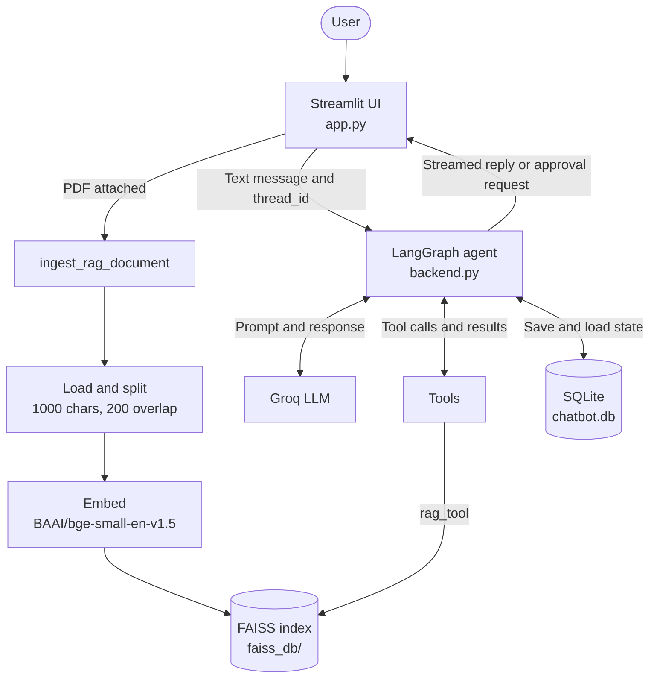
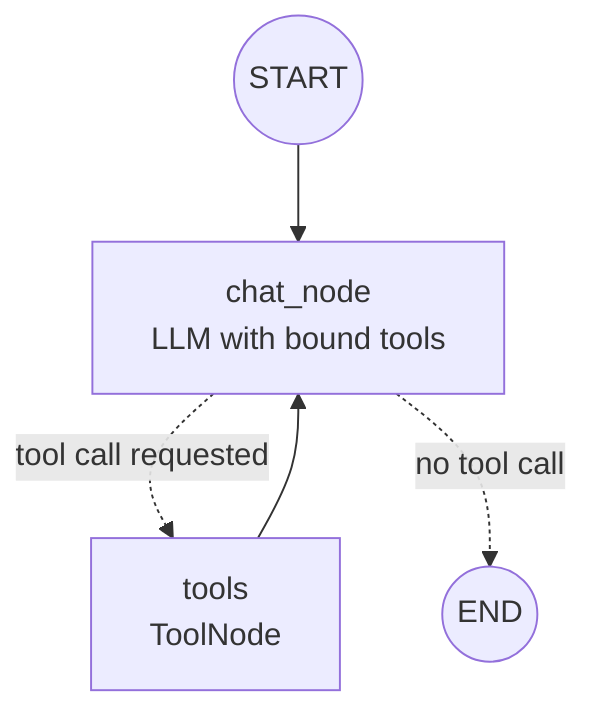
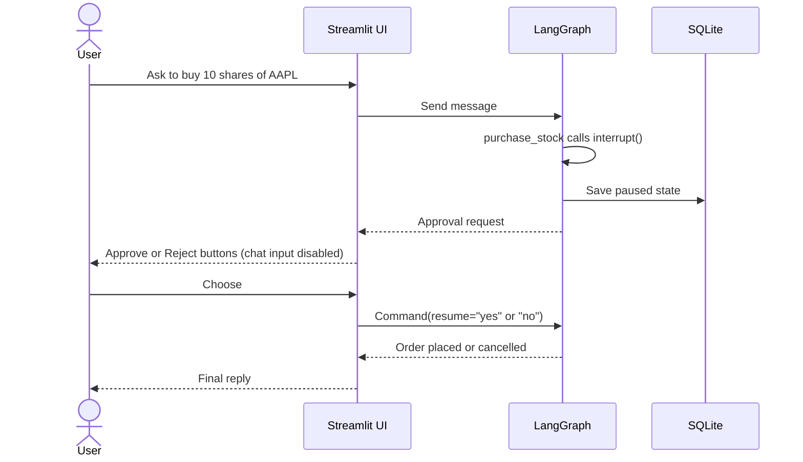

# AgenticChatBotWithLangGraph

An agentic chatbot built with **LangGraph**, **Groq** and **Streamlit**. The model decides when to call a tool, can answer questions about an uploaded PDF, saves conversations in SQLite, and asks for human approval before a (simulated) stock purchase.

## Features

- **Tool calling:** web search, calculator, stock price, weather, PDF retrieval and stock purchase
- **PDF question answering (RAG):** upload a PDF from the chat input and ask about it
- **Human-in-the-loop:** stock purchases pause until you approve or reject them
- **Saved conversations:** each chat has its own thread, stored in `chatbot.db`
- **Streaming:** replies appear as they are generated, with a status box for tool use

## Application Flow



## LangGraph Graph

The graph has two nodes. `tools_condition` sends the run to `tools` when the model requests a tool, and ends it otherwise. Tool results go back to `chat_node`, so the model can call more tools before giving its final answer.



**State:** `ChatState` holds one field, `messages`, which the `add_messages` reducer appends to.

**Document awareness:** on each call, `chat_node` checks for `faiss_db/index.faiss` and tells the model in the system prompt whether a PDF has been indexed.

## Tools

| Tool | What it does | Service |
| --- | --- | --- |
| `tavily_search` | Searches the web (up to 5 results) | Tavily |
| `calculator` | Evaluates math expressions | Local Python |
| `get_stock_price` | Gets the latest quote for a stock symbol | Alpha Vantage |
| `get_current_weather` | Gets current weather for a location | OpenWeather |
| `rag_tool` | Retrieves the 4 most similar chunks from the PDF | FAISS |
| `purchase_stock` | Simulates a stock purchase after human approval | Local, no real orders |

## Human-in-the-Loop Flow



Because the paused state is saved in the checkpoint, a pending approval can be restored by reopening its conversation.

## Getting Started

### Prerequisites

- Python (the local environment used for this project is 3.12)
- API keys for [Groq](https://console.groq.com/) and [Tavily](https://tavily.com/)
- An [OpenWeather](https://openweathermap.org/api) API key for the weather tool

### Installation

```bash
git clone https://github.com/Janardhan-AIConsultant/AgenticChatBotWithLangGraph.git
cd AgenticChatBotWithLangGraph

python -m venv .venv
# Windows (PowerShell)
.venv\Scripts\Activate.ps1
# macOS / Linux
source .venv/bin/activate

pip install -r requirements.txt
```

### Configuration

Create a `.env` file in the project root:

```env
GROQ_API_KEY=your_groq_api_key
GROQ_MODEL=your_groq_model_id
TAVILY_API_KEY=your_tavily_api_key
OPENWEATHER_API_KEY=your_openweather_api_key
ALPHAVANTAGE_API_KEY=your_alphavantage_api_key
```

| Variable | Required | Description |
| --- | --- | --- |
| `GROQ_API_KEY` | Yes | Groq API key |
| `GROQ_MODEL` | Yes | ID of a Groq model that supports tool calling |
| `TAVILY_API_KEY` | Yes | Tavily API key for web search |
| `OPENWEATHER_API_KEY` | For weather | OpenWeather API key |
| `ALPHAVANTAGE_API_KEY` | For stock prices | [Alpha Vantage](https://www.alphavantage.co/support/#api-key) API key |
| `GROQ_BASE_URL` | No | Defaults to `https://api.groq.com` |
| `GROQ_TEMPERATURE` | No | Defaults to `0` |

### Run

```bash
streamlit run app.py
```

Streamlit prints the local URL, usually <http://localhost:8501>. The embedding model is downloaded the first time it is needed, so the first start can take longer.

## Usage

| To try | Type |
| --- | --- |
| Web search | "What is the latest news about AI agents?" |
| Calculator | "What is math.sqrt(144) * 25?" |
| Stock price | "What is the current price of AAPL?" |
| Weather | "What's the weather in London?" |
| PDF questions | Attach a PDF, then ask "Summarize the document" |
| Stock purchase | "Buy 10 shares of TSLA" |

Use **New Chat** in the sidebar to start a conversation, or select a thread ID to reopen one.

## Project Structure

```text
.
├── app.py              # Streamlit UI, PDF upload, approval buttons
├── backend.py          # LLM, tools, RAG, LangGraph graph, checkpointer
├── requirements.txt    # Python dependencies
├── LICENSE
└── README.md
```

The app creates `faiss_db/` (PDF index) and `chatbot.db` (conversations) while running.

## Known Limitations

This is a learning/demo project. Review these before using it anywhere shared:

- **One shared PDF index:** all conversations use the same `faiss_db/`, and each upload replaces it. Only PDF files are accepted.
- **Calculator safety:** it uses Python's `eval`. Removing built-ins does not make it a secure sandbox, so don't expose it to untrusted users.
- **Index loading:** FAISS loads with `allow_dangerous_deserialization=True`, which uses pickle. Only load an index you created yourself.
- **No authentication:** anyone who can open the app can see all saved conversations.
- **Simulated trading:** `purchase_stock` never places a real order.

## License

Licensed under the [Apache License 2.0](LICENSE).
